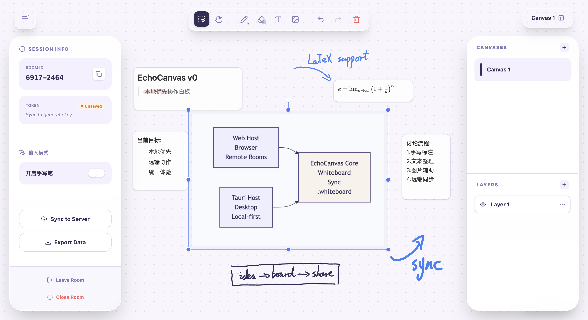
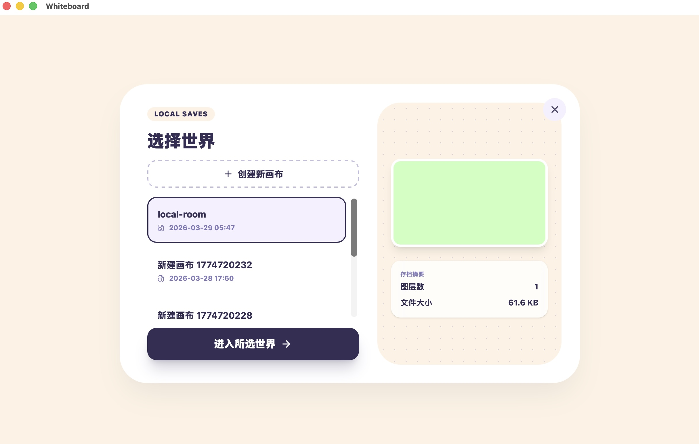
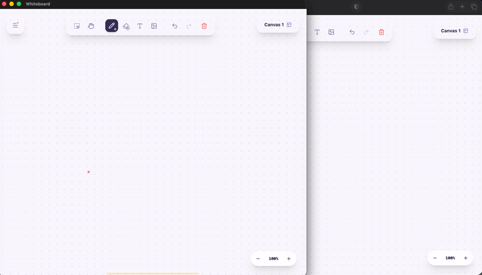

# EchoCanvas

[中文说明](./README.zh-CN.md)

EchoCanvas is a local-first whiteboard that combines multiplayer collaboration, local ownership, and flexible self-hosted deployment.

- Web and Tauri hosts
- Self-hosted multiplayer and local `.whiteboard` saves
- Interaction details refined for handwriting and discussion

## Why EchoCanvas

EchoCanvas started from a simple frustration: many whiteboards and collaboration tools become harder to use exactly when a small team needs them most.

- **Collaboration should not depend on platform friction.**
  Small-team discussion should not be interrupted by meeting limits, account walls, room rules, or subscription gates. A whiteboard should stay available when people need it, not only when a platform allows it.

- **Users should own their data, deployment path, and extension options.**
  Instead of locking storage, sync, OCR, or collaboration behind a single hosted platform, EchoCanvas is built around local ownership and self-hosted flexibility. If you want to keep everything local, connect to your own server, or extend the workflow on your own terms, you should be able to do that.

This project began as a real small-team collaboration need, and then grew into a longer-running personal project. The goal is to build a whiteboard that feels more controllable, more flexible, and less platform-bound than the tools I had on hand.

## What It Includes

- **Local-first ownership**
  Supports local `.whiteboard` files and workflows that do not treat a vendor-controlled account system as the default source of truth.

- **Self-hosted collaboration**
  Supports multiplayer rooms on self-managed infrastructure, including personal servers, LAN use cases, and remote access, rather than requiring a single official hosted service.

- **Web + desktop hosts**
  The same whiteboard product is available through both a Web host and a Tauri desktop host, each optimized for its runtime environment.

- **Whiteboard workflows for real use**
  This is not a one-off demo. The project has been iterated through repeated real use, with ongoing attention to handwriting, text, selection, touch, and mixed-content workflows.

## Architecture at a Glance

EchoCanvas is not just a canvas that can draw lines. It is a whiteboard system that spans different host environments. It tries to separate runtime, collaboration, and local ownership concerns without turning them into disconnected products.

- **Web host**
  Browser-first runtime for self-hosted rooms, remote collaboration, and deployed server access.

- **Tauri host**
  Desktop-first runtime for local `.whiteboard` files and local-first usage, while still being able to connect to remote or LAN servers.

- **One whiteboard core across two hosts**
  Web and Tauri are not unrelated projects. They are two host forms of the same whiteboard system, sharing the same product direction and collaboration semantics while differing in local capabilities and runtime model.

## Visual Overview

### Tauri local-first lobby

### Web and Tauri sync demo

## Repository Layout

- [`tracks/web`](./tracks/web)
  Current browser-first line and the default path for active development.
- [`tracks/tauri`](./tracks/tauri)
  Current desktop host line, focused on local-first and desktop capabilities.
- [`tracks/base`](./tracks/base)
  Historical monolithic baseline kept for reference and comparison, not part of the current main narrative.
- [`archive`](./archive)
  Workspace-level migration notes and cross-track records.

## Getting Started

- The project has reached a usable `v0` state and will continue to evolve as a long-running personal project.
- Workspace overview and common commands: [`QUICKSTART.md`](./QUICKSTART.md)
- Web track guide: [`tracks/web/QUICKSTART.md`](./tracks/web/QUICKSTART.md)
- Tauri track guide: [`tracks/tauri/README.md`](./tracks/tauri/README.md)
- Current status and known limitations: [`PROJECT_STATUS.md`](./PROJECT_STATUS.md)

## Development Workflow

EchoCanvas was not designed once and then implemented in a single pass. It was gradually shaped through repeated iteration. The project uses an AI-assisted workflow for option exploration, implementation acceleration, and issue investigation, but the direction, tradeoffs, and final acceptance of each iteration still need to be decided manually.

Most capabilities were built by first making them runnable, then refining them through actual use, regression testing, and follow-up restructuring. The interaction model, collaboration behavior, persistence choices, and deployment path all evolved in this way rather than appearing fully formed at the start.

## Quick Start

- **Web**
  Start from [`tracks/web/QUICKSTART.md`](./tracks/web/QUICKSTART.md). The current Web track supports container-based startup through Docker Compose and is the default development path.

- **Tauri**
  Start from [`tracks/tauri/README.md`](./tracks/tauri/README.md). The desktop track can be run in development mode or distributed later as a packaged app, with local `.whiteboard` files as its local-first base.

- **Production / self-hosting**
  The production deployment path is already used in practice, but reverse proxy, tunnel, domain, and environment setup are still somewhat environment-specific rather than fully generalized for one-command public deployment.

## Status and Next Steps

- EchoCanvas is currently in a usable `v0` state: runnable, demoable, and still open to continued iteration.
- The current focus is no longer on proving the concept, but on making the project cleaner, more publishable, and easier to keep evolving.
- Planned next steps include:
  - adding a Tauri settings UI for runtime and server configuration
  - completing Tauri LAN host exposure and local network collaboration entry points
  - continuing to align the Web and Tauri host experience around the same whiteboard core

## Development Defaults

- Default Web development path: `tracks/web`
- Default Tauri development path: `tracks/tauri`
- Production deployment directories are environment-specific and intentionally not fixed in the public repo
- `tracks/base` is read-only by default

## License

- Released under `AGPL-3.0-or-later`
- Copyright (C) 2026 Alan Wang
- The Web host includes a source repository entry point; the Tauri host entry will be added later

## Notes

- The repository is evolving as one whiteboard core across two host forms
- Web and Tauri try to stay aligned in interaction and product semantics
- Production deployment details and private local environment variables are not committed to GitHub
